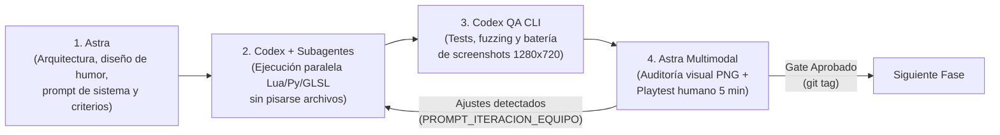

# 00 — Pudú Fantasy: Playbook Maestro de Hackathon (Codex + Astra + Subagentes)

> **Bienvenido al Playbook de Producción de _Pudú Fantasy — Batallas de Prompts al Compás_.**  
> Esta guía maestra documenta el plan exacto, paso a paso, para recrear el juego desde cero en formato hackathon (**24 h** o **48 h**) orquestando un estudio virtual de **8 subagentes en paralelo** con **Codex** (ejecución de ingeniería y QA) y **Astra** (dirección creativa, diseño de humor, arquitectura y crítica visual multimodal).

---

## 1. Visión General del Proyecto

**Pudú Fantasy — Batallas de Prompts al Compás** es un RPG humorístico **HD-2D** en **LÖVE2D 11.5 (LuaJIT + GLSL)** con puente local de **Google Gemini AI (Python 3)** inspirado en:
- **Final Fantasy / Pokémon**: overworld explorable diagonal (`↗`) a través de **4 biomas chilenos** (*Bosque Valdiviano -> Desierto de Atacama -> Costa de Valparaíso -> Ciudad y Gran Oficina*), transición clásica de encuentro (`!` + cortinilla iris/shutter) hacia una arena lateral dedicada, HUD minimalista azul real biselado y **9 encuentros cómicos**.
- **Mario & Luigi: Superstar Saga**: baile idle expresivo del Pudú clavado al **BPM real** de la música (con física de resorte en su sombrero puntiagudo de mago) y groove reactivo de los rivales, **sin** mecánicas punitivas de notas que caen.
- **Scribblenauts + Improvisación "Yes, And..."**: en tu turno escribes **CUALQUIER objeto, animal, clima o locura**. Mientras **Gemini 2.5 Flash** juzga la causa-efecto cómica en un esquema estricto de **34 campos JSON** (`thinkingBudget: 0`, `<1 s`) y **Gemini 2.5 Flash Image** sintetiza un sprite 16-bit HD-2D en vivo (en paralelo especulativo, con recorte chroma y normal map Sobel `_n.png`), ejecutas un **ritual de flechas direccionales brillantes** (`+8%` de poder por flecha) que transforma la espera de red en juego activo.
- **Combos de 2 Turnos y Rejugabilidad**: **8 estados físicos de escenario** (`mojado`, `congelado`, `aceitoso`, `enjabonado`, `oscuro`, `ruidoso`, `caliente`, `pegajoso`) que encadenan **6 Super-Combos** devastadores, **14 gags instantáneos pre-cacheados**, **5 finales cómicos de derrota**, galería persistente **"Álbum de Locuras" (`[J]`)**, **Panel Director (`[F2]`)** para artistas/diseñadores, y **modo 100% offline/standalone** en Lua puro para que la demo jamás dependa del WiFi del recinto.

---

## 2. Dos Caminos Oficiales de Assets (Modo A vs. Modo B)

El motor está diseñado desde la Fase 0 para desacoplar **100%** la lógica de combate de los archivos finales de arte y música. Elige el camino que mejor encaje con tu equipo al comenzar la hackathon:

| Dimensión | **Modo A — Assets Pre-hechos** | **Modo B — Greybox -> Drop-In** |
| :--- | :--- | :--- |
| **¿Cuándo elegirlo?** | Ya tienes los sprites (`diffuse.png` + `*_n.png`), retratos, tiles y pistas de audio listos en `assets/` al arrancar la Fase 0 (o generados previamente con `sprite_studio.py` / Lyria 3). | Empiezas con un repo completamente vacío o el artista y músico del equipo van a producir el arte/música **en paralelo** durante la hackathon. |
| **Fases 0 a 5** | `loadAllSprites()` carga tus sprites y mapas de normales reales desde el día 1; las capturas de Astra ya evalúan iluminación HD-2D real. | El juego arranca con **siluetas vectoriales / placeholders de color** y audio stub/silencioso sin crashear. Programadores avanzan a máxima velocidad sin esperar a arte. |
| **Fase 6 (Drop-In)** | Calibración fina de escalas, offsets y presets de luz con Panel Director `[F2]` y guardado en `stage_overrides.json`. | El artista suelta sus PNGs en `assets/sprites/` o **`assets/custom/<id>.png`**, corre el generador de normales Sobel (`*_n.png`), el músico actualiza `Audio.TRACK_META` (`bpm`, `beatOffset`), y todo aparece **en vivo pulsando `[F5]`** sin refactorizar una sola línea de lógica. |
| **Riesgo principal a vigilar** | Que un sprite tenga halo magenta o falte su par `_n.png`. | Dejar el ajuste de proporciones/anclas para el último minuto (mitigado con guías de ancla en `[F2]`). |

> [!TIP]
> **Ventaja del Hot-Reload `[F5]` y `assets/custom/`**: Tanto en desarrollo desde carpeta como en el `.exe` Windows fusionado, `loadAllSprites()` prioriza `assets/custom/<encounter_id>.png` (+ `_n.png`) sobre `assets/sprites/encounters/<id>.png`. El artista puede iterar un personaje y ver el resultado iluminado en 1 segundo sin reiniciar el juego.

---

## 3. Mapa Completo de las 8 Fases de Desarrollo (Fase 0 a Fase 7)

Cada fase cuenta con su guía detallada en `phases/`, prompts listos para Codex/Astra, comandos de verificación CLI y criterios objetivos de salida.

| Fase | Nombre y Guía | Objetivo Principal | Deliverables Clave | Hackathon 24 h | Hackathon 48 h | Playtest Gate Obligatorio |
| :---: | :--- | :--- | :--- | :---: | :---: | :--- |
| **00** | [FASE 00 — Pre-Producción, Arquitectura Base y Setup](./phases/FASE_00_PREPRODUCCION_Y_SETUP.md) | Inicializar repo, `AGENTS.md`, `conf.lua`, esqueleto `main.lua`, `json.lua`, stub de `encounters.lua`, Modo A/B y harness CLI. | Repo operativo, parser CLI `%-%-`, `love.errorhandler` con `os.exit(1)`, estructura `assets/`. | 1.0 h | 2.0 h | `love . --mock --quit-after=2` retorna exit code `0`. |
| **01** | [FASE 01 — Vertical Slice Overworld `↗` y Transición JRPG](./phases/FASE_01_VERTICAL_SLICE_OVERWORLD.md) | Mapa diagonal `↗` continuo de 4 biomas (`u=0..118`), cámara calma room-snapped, minimapa y transición `!` + cortinilla JRPG. | `stage_renderer.lua` (overworld + transición), movimiento 8-dir, 4 biomas navegables. | 2.5 h | 5.0 h | Capturas de 4 biomas + `--transition-preview=0.5` aprobadas en Astra; cámara sin mareo. |
| **02** | [FASE 02 — Arena HD-2D, Dash-in y Baile al Compás](./phases/FASE_02_ARENA_Y_BAILE_AL_COMPAS.md) | Escenario lateral de batalla, 8 temas de arena, shaders normal-mapped (`safeSend`), baile idle al BPM + sombrero con física de resorte. | `shaders.lua`, `lighting_pipeline.lua`, `beat_sync.lua`, `battle_enter` dash-in, 4 presets de luz. | 3.0 h | 6.0 h | Baile clavado al BPM sin drift, `0` warnings GLSL, contraste verificado en día/noche. |
| **03** | [FASE 03 — Motor IA de Prompts, 9 Rivales y Combos](./phases/FASE_03_MOTOR_IA_PROMPTS_Y_COMBOS.md) | Cerebro IA 2 etapas (`gemini-2.5-flash` `thinkingBudget=0` + `gemini-2.5-flash-image`), 34 campos JSON, 9 rivales, 8 estados, 6 super-combos y fallback offline. | `ai_bridge.py`, `battle_worker.lua`, `sprite_worker.lua`, `encounters.lua` completo. | 3.0 h | 6.0 h | Stage 1 `<1 s`, 6 super-combos y modo 100% offline validados con fuzzing JSON. |
| **04** | [FASE 04 — Ritual de Flechas y UX Minimalista](./phases/FASE_04_RITUAL_FLECHAS_Y_UX_CLEAN.md) | Minijuego de flechas convexas brillantes (time-buying con flechas doradas), anticipación del rival, HUD Final Fantasy sin spoilers y semi-pista tras 2 fallos. | `spell_ritual.lua`, `battle_hud.lua`, carriles zero-overlap, iconos vectoriales (0 tofu). | 2.5 h | 5.0 h | `--test-ritual` y flujo prompt->ritual->vuelo sin solapes, 0 cajas `[X]`, flechas nítidas. |
| **05** | [FASE 05 — VFX Zero-Overlap, Combos, Finales y Álbum](./phases/FASE_05_VFX_ZERO_OVERLAP_Y_FINALES.md) | 6 trayectorias de invocación, 16 sistemas de partículas, 15 reacciones, 6 espectáculos de combo, 5 finales cómicos y modal 3×3 "Álbum de Locuras" `[J]`. | `battle_fx.lua`, `victory_album.lua`, `victory_album.json` persistente. | 3.0 h | 6.0 h | 4 `--demo-combo` + `--open-album` verificados a 60 FPS; globos silenciados en ritual/victoria. |
| **06** | [FASE 06 — Assets HD-2D, Audio y Panel Director `[F2]`](./phases/FASE_06_ASSETS_AUDIO_Y_DIRECTOR.md) | Drop-in de arte real + `_n.png` Sobel, hot-reload `[F5]`, música sincronizada (`static` + `beatOffset`), 19 SFX cómicos/rituales y Panel Director `[F2]`. | `audio.lua`, `director_panel.lua`, `stage_overrides.json`, generadores `tools/*.py`. | 3.5 h | 7.0 h | Artista prueba `[F5]` en vivo, músico valida sync BPM, capturas `[H]`+`[F12]` aprobadas. |
| **07** | [FASE 07 — QA Visual, Fuzzing y Build Windows `.exe`](./phases/FASE_07_QA_VISUAL_Y_BUILD_DEMO.md) | Auditoría integral de assets y `LUA_FILES`, batería CLI de screenshots, fuzzing online/offline, build portable Windows x64 y guion de demo de 3 min. | `tools/build_windows_exe.py`, `PuduFantasy.exe`, `PuduFantasy-Windows-x64.zip`, `screenshots/qa_final/`. | 1.5 h | 3.0 h | Checklist de 12 puntos en Astra en verde + smoke test `.exe` con puerto `18425` apagado. |
| **Buffer** | **Iteración en equipo, descanso y ensayo de pitch** | Margen para rondas de iteración (`PROMPT_ITERACION_EQUIPO.md`) y pruebas con usuarios externos. | Demo invencible + Plan B offline ensayado. | 4.0 h | 8.0 h | Pitch cronometrado de 3:00 min sin fallos. |
| **TOTAL** | | | | **24.0 h** | **48.0 h** | |

---

## 4. Gate de Iteración en Equipo (Regla de Oro)

> [!IMPORTANT]
> **Regla de Oro de Producción**: **NUNCA** avances a la fase `N + 1` sin pasar el **Playtest Gate + Verificación Visual** de la fase `N`. Un bug de overlap, un glifo tofu o una desincronización de contrato que se deja pasar en Fase 2 cuesta 5× más caro arreglarlo en Fase 6.

Todo Gate de fase consta exactamente de **3 controles rápidos (10–15 minutos totales)**:

1. **Control Técnico Automático (Codex)**:
   - Ejecutar `python3 -m py_compile` en scripts Python tocados y correr los comandos CLI de la fase con `--quit-after=... --print-perf` comprobando **`exit code == 0`** y FPS estables.
2. **Control Visual Multimodal (Astra)**:
   - Generar capturas PNG en `1280×720` vía `--screenshot=screenshots/...` y pasarlas a **Astra** para auditar: **cero solapamiento de texto/UI**, **cero cajas tofu `[X]`**, **flechas convexas íntegras**, **bloom/iluminación sin halos quemados** y **siluetas legibles**.
3. **Playtest Humano de 5 Minutos + Ronda de Iteración**:
   - El equipo juega la build en vivo 5 minutos anotando lo que se siente lento, confuso o poco gracioso.
   - Si surgen ajustes, se aplica [templates/PROMPT_ITERACION_EQUIPO.md](./templates/PROMPT_ITERACION_EQUIPO.md) antes de cerrar la fase y etiquetar el checkpoint (`git tag gate-fase-0N`).

---

## 5. Cómo Combinar Codex + Astra (División de Poderes)

Usar la herramienta correcta para cada tipo de trabajo multiplica la velocidad del equipo sin sacrificar calidad visual ni humor:

| Usa **Astra** para... | Usa **Codex (+ Subagentes)** para... |
| :--- | :--- |
| **Arquitectura y contratos**: revisar cambios al esquema JSON de 34 campos, máquina de estados y separación de módulos. | **Ejecución paralela con subagentes**: implementar en simultáneo 2–4 módulos con propiedad exclusiva de archivos (ver [02_ROLES_SUBAGENTES_CODEX_ASTRA.md](./02_ROLES_SUBAGENTES_CODEX_ASTRA.md)). |
| **Diseño de gameplay y comedia**: redactar y afinar `SYSTEM_INSTRUCTION`, remates chilenos ("Yes, And..."), semi-pistas sin spoilers y balanceo de los 9 encuentros + 6 combos. | **Código de producción**: escribir y refactorizar LuaJIT, shaders GLSL con `safeSend`, hilos `love.thread`, `ai_bridge.py` y utilidades Python (`sprite_studio.py`). |
| **Crítica visual multimodal**: inspeccionar screenshots PNG (`1280×720`) buscando overlaps, tofu, flechas deformadas, exceso de bloom o composición débil. | **Verificación y fuzzing automatizado**: correr baterías CLI `--screenshot` / `--quit-after`, fuzzing de 34 campos y paridad online/offline. |
| **Triage de playtesting y pitch**: sintetizar feedback del equipo en parches quirúrgicos y pulir el guion de demo de 3 minutos. | **Build y empaquetado**: ejecutar `tools/build_windows_exe.py`, validar cabecera PE `MZ`, integridad ZIP y smoke test standalone del `.exe`. |

---

## 6. Quickstart Paso a Paso (De Cero a Jugando en 10 Minutos)

### Paso 0 — Requisitos del entorno local
- **LÖVE2D 11.5** instalado (macOS: `/Applications/love.app/Contents/MacOS/love` o `love` en `PATH`; Windows: `love.exe` 11.5 x64).
- **Python 3.10+** con `Pillow` y `numpy` (`pip install -r requirements.txt`).
- **Credenciales IA (opcionales para empezar, el juego corre 100% offline con `--mock`)**:
  - Opción A (Vertex AI): `gcloud auth application-default login` + `GOOGLE_CLOUD_PROJECT=<tu-proyecto>`.
  - Opción B (Gemini Developer API): copiar `.env.example` a `.env` y configurar `GEMINI_API_KEY=...`.

### Paso 1 — Inicializar el repositorio con `AGENTS.md`
1. Crea tu repositorio limpio (ej. `mkdir pudu-fantasy && cd pudu-fantasy && git init`).
2. Copia [templates/AGENTS_TEMPLATE.md](./templates/AGENTS_TEMPLATE.md) como **`AGENTS.md`** en la raíz del repositorio nuevo. Ese archivo actúa como constitución vinculante para Codex y todos sus subagentes (reglas de LÖVE 11.5, cero tofu, flechas convexas, `safeSend`, `%-%-` en CLI, carriles zero-overlap y propiedad de archivos).
3. Decide y anota en la cabecera si el equipo arrancará en **Modo A (Assets Pre-hechos)** o **Modo B (Greybox -> Drop-In)**.

### Paso 2 — Abrir `FASE_00` y lanzar el Prompt Maestro
1. Abre [phases/FASE_00_PREPRODUCCION_Y_SETUP.md](./phases/FASE_00_PREPRODUCCION_Y_SETUP.md) junto con [01_ARQUITECTURA_Y_CONTRATOS.md](./01_ARQUITECTURA_Y_CONTRATOS.md).
2. Lanza el **Prompt Maestro** en **Codex**, asignando los subagentes definidos en [02_ROLES_SUBAGENTES_CODEX_ASTRA.md](./02_ROLES_SUBAGENTES_CODEX_ASTRA.md) para esa fase.
3. Ejecuta el comando de verificación CLI de la fase y captura las primeras pantallas en `screenshots/`.

### Paso 3 — Iterar en equipo con Astra + `PROMPT_ITERACION_EQUIPO.md`
1. Sube las capturas PNG a **Astra** y juega 5 minutos en equipo.
2. Reúne los ajustes de humor, timing, iluminación o UI usando [templates/PROMPT_ITERACION_EQUIPO.md](./templates/PROMPT_ITERACION_EQUIPO.md) y aplícalos en Codex con cambios quirúrgicos por dueño de archivo.
3. Vuelve a capturar y verificar que no haya regresiones.

### Paso 4 — Aprobar el Gate, etiquetar y avanzar
1. Comprueba el checklist *Definition of Done* de la fase actual.
2. Haz commit limpio y crea tag de seguridad (`git commit -m "feat: completar fase 00" && git tag gate-fase-00`).
3. Repite el ciclo fase por fase (`FASE 00` -> `FASE 07`) hasta obtener `dist/PuduFantasy-Windows-x64.zip` validado en modo standalone y el pitch de 3 minutos ensayado.

---

## 7. Mapa de Documentación del Paquete

- **`00_README_HACKATHON_PLAYBOOK.md`** *(este documento)* — Visión, Modo A/B, mapa de 8 fases, ciclo Codex + Astra y Quickstart.
- **[`01_ARQUITECTURA_Y_CONTRATOS.md`](./01_ARQUITECTURA_Y_CONTRATOS.md)** — Stack exacto, matriz de propiedad de módulos, máquina de estados, esquema JSON de 34 campos, 9 encuentros, 4 biomas, 14 gags, 8 estados, 6 super-combos, CLI y lecciones de producción.
- **[`02_ROLES_SUBAGENTES_CODEX_ASTRA.md`](./02_ROLES_SUBAGENTES_CODEX_ASTRA.md)** — Los 8 subagentes especialistas, matriz Fase × Subagentes × Herramienta, protocolo anti-conflictos y 8 prompts de sistema listos para pegar.
- **`phases/` (`FASE_00_PREPRODUCCION_Y_SETUP.md` a `FASE_07_QA_VISUAL_Y_BUILD_DEMO.md`)** — Guías ejecutables por fase con prompts maestros, comandos CLI y Playtest Gates.
- **[`templates/AGENTS_TEMPLATE.md`](./templates/AGENTS_TEMPLATE.md)** — Plantilla de `AGENTS.md` para pegar en la raíz del repositorio nuevo.
- **[`templates/PROMPT_ITERACION_EQUIPO.md`](./templates/PROMPT_ITERACION_EQUIPO.md)** — Plantilla estructurada para las rondas de feedback y pulido tras cada playtest de fase.
