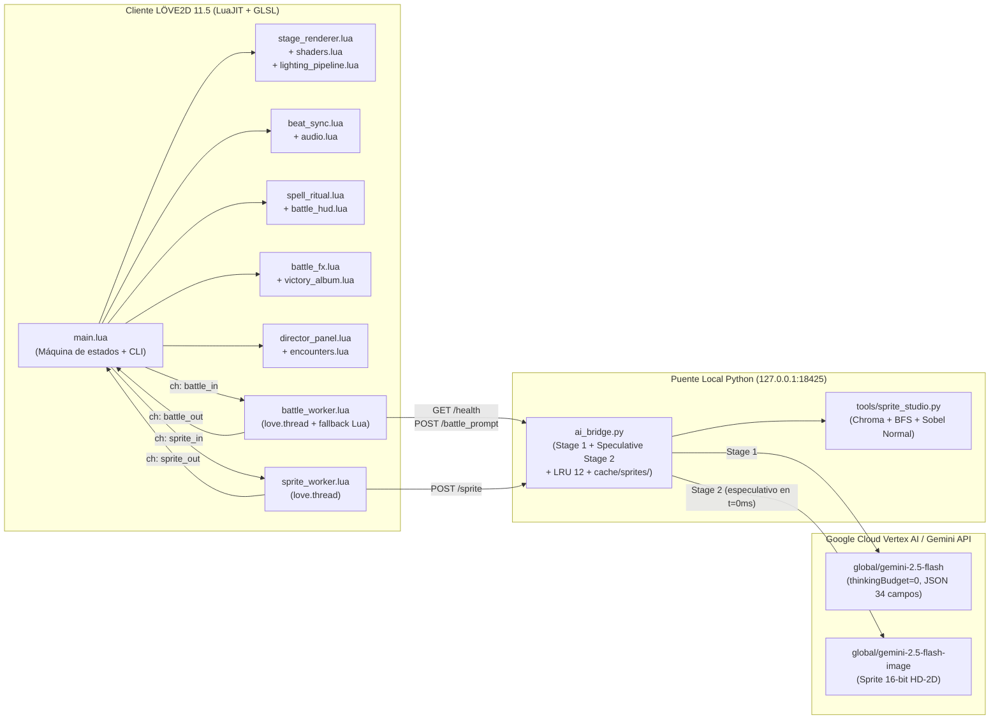
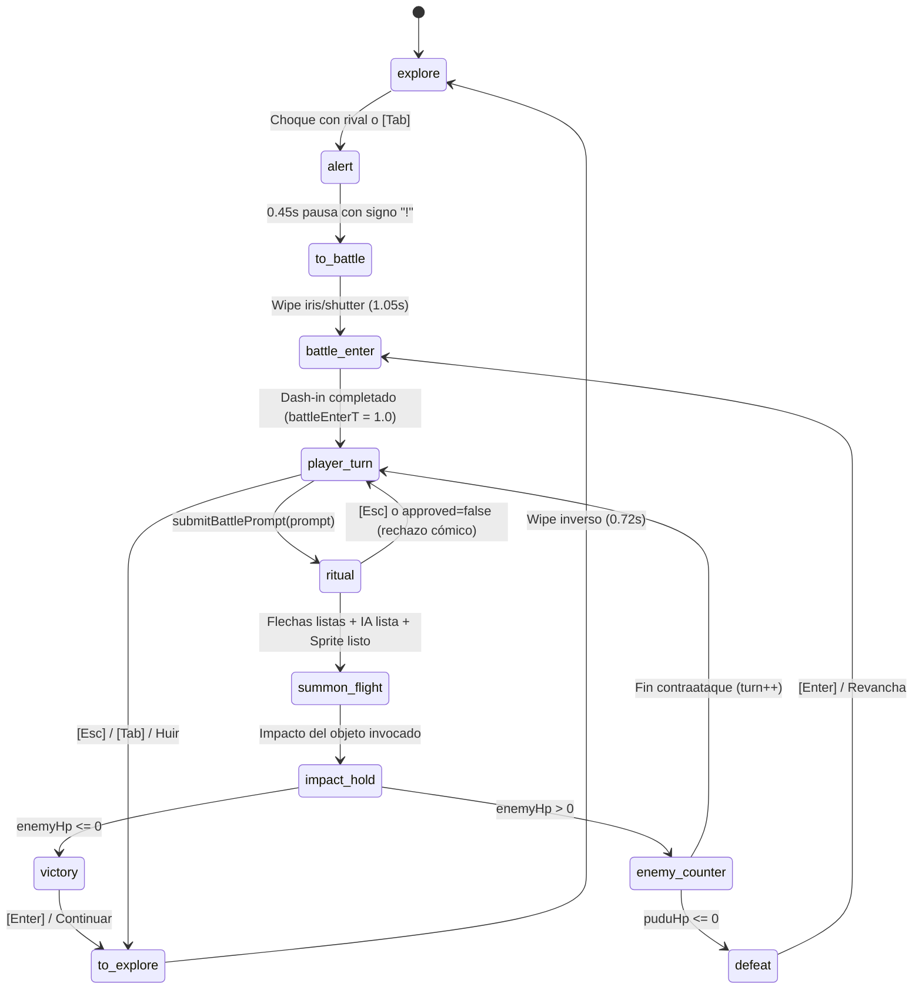

# 01 — Arquitectura Técnica y Contratos Inmutables

> **Propósito de este documento**: Definir la fuente única de verdad técnica para construir **Pudú Fantasy — Batallas de Prompts al Compás** desde cero con múltiples subagentes en paralelo (Codex + Astra). Ningún subagente puede romper los contratos aquí especificados sin actualizar primero este documento y avisar al `Architect & Integrator`.

---

## 1. Stack Técnico Exacto

| Capa | Tecnología / Modelo | Especificación Canónica |
| :--- | :--- | :--- |
| **Motor Cliente** | **LÖVE2D 11.5** (LuaJIT + GLSL) | Ventana `1280×720` (`minwidth=960`, `minheight=540`, `resizable=true`, `vsync=1`, `msaa=0`, `highdpi=false`), `t.identity = "pudu_fantasy_battle"`. Módulos desactivados en `conf.lua`: `joystick`, `physics`, `touch`, `video`. |
| **Hilos y Red Cliente** | `love.thread` + `love.thread.getChannel` + `socket.http` + `ltn12` | 2 hilos dedicados (`battle_worker.lua` y `sprite_worker.lua`) para garantizar **0 frame drops** durante llamadas HTTP locales y decodificación de sprites. |
| **Puente Local IA** | **Python 3.10+** (`ai_bridge.py`) | `ThreadingHTTPServer` en `127.0.0.1:${PUDU_BATTLE_PORT}` (default `18425`). Pool HTTPS persistente (`keep-alive`), `ThreadPoolExecutor` para especulación Stage 2, Pillow + NumPy (`tools/sprite_studio.py`) para chroma-key, flood-fill y normal map Sobel. |
| **Autenticación IA** | **Vertex AI (ADC `gcloud`)** o **Gemini Developer API** | Prioriza Google Cloud Vertex AI (`gcloud auth application-default login` + `GOOGLE_CLOUD_PROJECT`) y hace fallback transparente a `GEMINI_API_KEY` (leída de `.env` o variables de entorno). |
| **Stage 1 — Juez Cómico** | `global/gemini-2.5-flash` | `thinkingConfig: { "thinkingBudget": 0 }`, `temperature: 0.55`, `maxOutputTokens: 850`, `responseMimeType: "application/json"`, `responseSchema` estricto de **34 campos** (~650–900 ms). |
| **Stage 2 — Sprites en Vivo** | `global/gemini-2.5-flash-image` | `responseModalities: ["IMAGE"]`, `temperature: 0.35`. Referencia de estilo `assets/sprites/pudu_hero.png` (compactada), fondo `#FF00FF`, recorte chroma + BFS de esquinas + `trim_and_pad_sprite` + mapa de normales Sobel. Caché RAM LRU de **12 slots** + disco en `cache/sprites/`. |
| **Música (Pipeline Opcional)** | `global/lyria-3-pro-preview` (`tools/generate_lyria3_music.py`) | Genera 5 tracks instrumentales (`overworld`, `superstar`, `boss`, `plaza`, `victory`), analiza BPM exacto, corta a múltiplos de 4 compases con crossfade de potencia constante, normaliza a `-1.5 dBFS` y exporta a `.ogg` Vorbis. |
| **Empaquetado Windows** | `tools/build_windows_exe.py` | Fusiona `tools/love-win64/love.exe` + `PuduFantasy.love` en `dist/PuduFantasy-Windows/PuduFantasy.exe` (PE Win64 válido), copia DLLs, puente IA opcional y carpetas hot-reload (`assets/custom/`, `screenshots/`), y genera `dist/PuduFantasy-Windows-x64.zip`. |

### Diagrama de Arquitectura y Flujo de Datos



---

## 2. Arquitectura de Módulos y Propiedad Estricta de Archivos (Ownership Matrix)

Para que varios subagentes de Codex trabajen en paralelo **sin pisarse código**, cada archivo tiene **un único dueño escritor**. Los demás roles solo pueden leer el archivo o consumir su interfaz pública.

| Archivo | Rol Propietario | Responsabilidad Exacta | Restricciones |
| :--- | :--- | :--- | :--- |
| `conf.lua` | `Architect & Integrator` | Configuración de ventana `1280×720`, versión `11.5`, identidad y módulos LÖVE. | No meter lógica de juego. |
| `main.lua` | `Architect & Integrator` | Ciclo `love.load/update/draw/keypressed/mousepressed`, máquina de estados, carga de assets + hot-reload `[F5]`, bombeo de hilos, parser CLI y capturas `--screenshot`. | Solo el integrador edita `main.lua`; no meter lógica pesada de shaders, VFX ni JSON de IA aquí. |
| `json.lua` | `Architect & Integrator` | Codificador/decodificador JSON puro en Lua compartido por cliente y workers. | Inmutable una vez validado en Fase 0. |
| `encounters.lua` | `AI Prompt & Combo Engineer` | Catálogo de **4 biomas**, **8 stage themes**, **9 encuentros** (`LIST`), helpers `getById/getByIndex/getBiomeAtU`, lectura/escritura de `stage_overrides.json`. | Sin dependencias de `love.graphics`. |
| `stage_renderer.lua` | `Overworld & Stage Tech-Artist` | Proyección diagonal `↗` (`ISO_UX=62, ISO_UY=-31`), cámara calmada room-snapped, render de 4 biomas, 8 arenas de batalla, transición shutter/iris, minimapa diagonal, guías de artista y `safeSend`. | No mutar estado de combate (`Game.enemyHp`, turnos). |
| `shaders.lua` | `Overworld & Stage Tech-Artist` | Shaders GLSL (G-Buffer MRT 4 targets, deferred lights, JFA SDF, Radiance Cascades GI, Dual-Kawase Bloom, ACES tone mapping, agua, sunbeams, `lit` fallback) y wrapper cacheado `Shaders.send`. | Toda llamada a uniform debe pasar por `hasUniform`. |
| `lighting_pipeline.lua` *(módulo avanzado HD-2D)* | `Overworld & Stage Tech-Artist` | Orquestador de los 3 pilares HDR (`rgba16f` + Bloom 5 niveles + Deferred 256 luces + JFA SDF + Radiance Cascades 2D GI) con fallback seguro a canvas clásico. | Si se usa, **debe** incluirse en `LUA_FILES` de `tools/build_windows_exe.py`. |
| `beat_sync.lua` | `Character Animation & Rhythm Specialist` | Tracker musical con PLL anti-drift sobre `audio:getTrackState()`, poses de baile idle estilo *Superstar Saga*, física de resorte del sombrero de mago, groove enemigo por reacción. | Sin llamadas de red ni render directo de HUD. |
| `spell_ritual.lua` | `Spell Ritual & Minimalist UI Designer` | Minijuego de flechas direccionales brillantes durante espera IA, flechas doradas de sobrecarga (time-buying), círculo arcano, orbe creciente, `+8%` poder por flecha, flechas dibujadas como 2 polígonos convexos. | Cero dependencias del bridge HTTP; recibe `setAiReady()` y `setSpriteReady()` desde `main.lua`. |
| `battle_hud.lua` | `Spell Ritual & Minimalist UI Designer` | HUD minimalista estilo Final Fantasy (ventanas azul real biseladas), barra de rival anclada al escenario, caja de prompt UTF-8, banners, botones hit-test e iconos vectoriales (sin Unicode decorativo). | Prohibido mostrar spoilers de debilidades o desorden de puntos de beat. |
| `battle_fx.lua` | `Combat VFX, Finales & Album Specialist` | Animaciones de invocación (6 `delivery_style`), 16 sistemas de partículas (`MAX_PARTICLES=420`), hasta 3–4 props persistentes, overlays de reacción, textos flotantes, globos de diálogo, hit-stop, screen shake y finales cómicos de derrota + espectáculos de super-combo. | No decide daño; consume el resultado ya evaluado. |
| `victory_album.lua` | `Combat VFX, Finales & Album Specialist` | Galería modal 3×3 "Álbum de Locuras" (`[J]`), registra victorias/combos/prompts en `victory_album.json` (soporta modo fuente y `.exe` fusionado) y permite revancha directa al hacer clic en una tarjeta. | Truncamiento UTF-8 seguro para acentos en español. |
| `audio.lua` | `Audio & Director Tools Engineer` | Gestor de tracks musicales `"static"` (zero-drift `tell("seconds")`) con `TRACK_META` (`bpm`, `beats`, `beatOffset`, `loop`), catálogo de SFX cómicos/ritual/fauna y escala pentatónica de flechas. | Nunca crashear si falta un `.wav`/`.ogg` (Modo B Greybox). |
| `director_panel.lua` | `Audio & Director Tools Engineer` | Panel Director `[F2]` con 3 pestañas (`encuentros`, `reacciones`, `grafica`), filtros por categoría, disparo de gags/combos rápidos, ajustes de escala/offsets/iluminación/clima, guardar `stage_overrides.json` y botón `[F5]`/`[F12]`. | Solo emite acciones `(btnId, payload)` que `main.lua` ejecuta. |
| `battle_worker.lua` | `AI Prompt & Combo Engineer` | Hilo LÖVE que escucha `battle_in`, llama `GET /health` y `POST /battle_prompt` y provee el **motor cómico fallback 100% offline en Lua** (9 encuentros + 2-turn combos). | Prohibido llamar a `love.graphics` dentro del hilo. |
| `sprite_worker.lua` | `AI Prompt & Combo Engineer` | Hilo LÖVE que escucha `sprite_in`, llama `POST /sprite` con `TIMEOUT=28s` y devuelve `diff_b64` + `norm_b64` en `sprite_out`. | Prohibido decodificar `love.graphics.newImage` en el hilo (la decodificación de textura se hace en el hilo principal en `main.lua`). |
| `ai_bridge.py` | `AI Prompt & Combo Engineer` | Servidor local HTTP, `SYSTEM_INSTRUCTION`, `RESPONSE_SCHEMA` (34 campos), `sanitize_battle_result`, pre-cache exacto, especulación paralela Stage 2, fallback Python y caché RAM+disco. | Nunca exponer claves ni fallar con HTTP 500 al cliente; ante error cloud degradar limpiamente a `fallback_battle_evaluate`. |
| `tools/build_windows_exe.py` | `QA Visual Auditor & Release Engineer` | Construye `.love`, fusiona `PuduFantasy.exe`, valida cabecera `MZ` + integridad ZIP, copia DLLs y puente opcional, empaqueta `PuduFantasy-Windows-x64.zip`. | Verificar siempre que `LUA_FILES` contiene **todos** los módulos requeridos por `main.lua`. |

---

## 3. Contratos Inmutables entre Módulos

### 3.1 Máquina de Estados (Overworld, Transición y Combate)

El juego separa estrictamente el **Modo Exploración (`explore`)** del **Escenario de Batalla (`battle`)**, conectados mediante una secuencia de transición JRPG (`transitionState`).



**Invariantes obligatorias de estado**:
1. **Bloqueo de input durante transiciones**: Si `Game.transitionState ~= "none"`, se ignoran entradas de juego (excepto teclas de herramienta `[F2]`, `[F5]`, `[F12]`).
2. **Semi-pista sin spoilers (`nonCritMissCount`)**: Si el jugador acumula **2 intentos no críticos consecutivos** contra un rival, el enemigo suelta su `semiHintLine` (pista sutil en personaje, nunca el nombre literal de la respuesta).
3. **Visibilidad limpia de globos**: Durante `ritual`, `victory` y `defeat` se ocultan los globos de diálogo estándar de `battleFX:drawSpeechBubbles`. Durante `ritual`, únicamente se muestra la píldora compacta de `anticipationLine` anclada sobre el rival (`x >= w * 0.58`), sin invadir el carril de flechas.
4. **Cierre de modal prioritario**: Si `album:isOpen()` o `director.open` está activo, captura clics antes que el HUD o el mundo.

---

### 3.2 Catálogo Canónico de Contenido

#### A) 4 Biomas Explorables (`encounters.lua`)
El overworld asciende diagonalmente de **abajo-izquierda (`u = 0`) hacia arriba-derecha (`u = 118`)** con proyección `ISO_UX = 62`, `ISO_UY = -31`, `ISO_VX = 62`, `ISO_VY = 31` y `ROOM_SPACING = 14.0`:

| # | `biome.id` | Nombre | Rango `u` | Stage Themes asociados |
| :-: | :--- | :--- | :---: | :--- |
| 1 | `bosque` | Bosque y Plaza Valdiviana | `0 .. 38` | `plaza`, `bosque` |
| 2 | `desierto` | Desierto de Atacama | `38 .. 64` | `mirador`, `vereda` |
| 3 | `costa` | Costa y Muelle de Valparaíso | `64 .. 90` | `muelle`, `pantano` |
| 4 | `ciudad` | Ciudad y Gran Oficina | `90 .. 118` | `esquina`, `oficina` |

#### B) 9 Encuentros Cómicos (`Encounters.LIST`)

| # | `id` | Nombre | Bioma | Stage | Categoría | Pos `(u, v)` | `maxHp` | Track | Debilidades clave |
| :-: | :--- | :--- | :--- | :--- | :--- | :---: | :-: | :--- | :--- |
| 1 | `nino_helado` | Niño del Helado Triple | `bosque` | `plaza` | `persona` | `(10.0, 0.2)` | 100 | `superstar` | lluvia, nube, agua, gaviota, viento, sol, plátano |
| 2 | `mimo_muro` | Mimo del Muro Invisible | `bosque` | `plaza` | `persona` | `(22.0, -2.0)` | 110 | `superstar` | pintura, balde, abeja, bocina, trompeta, agua, martillo |
| 3 | `puma_dramatico` | Puma Dramático | `bosque` | `bosque` | `animal` | `(34.0, 1.6)` | 120 | `boss` | lana, ovillo, pepino, barro, ducha, láser, caja, secador |
| 4 | `turista_selfie` | Turista del Selfie Infinito | `desierto` | `mirador` | `persona` | `(48.0, -1.2)` | 105 | `plaza` | lluvia, nube, paloma, espejo, viento, barro, batería |
| 5 | `gato_guaton` | Gato Guatón Inamovible | `desierto` | `vereda` | `animal` | `(60.0, 1.8)` | 110 | `plaza` | pepino, caja, láser, atún, pescado, agua, aspiradora |
| 6 | `gaviota_mafiosa` | Gaviota Mafiosa | `costa` | `muelle` | `animal` | `(74.0, -1.4)` | 115 | `superstar` | empanada, espantapájaros, manguera, agua, pescado, viento |
| 7 | `piscina_barro` | Pantano Traicionero | `costa` | `pantano` | `desafio` | `(86.0, 1.2)` | 120 | `boss` | puente, madera, secador, hielo, ventisca, esponja, sol, balsa |
| 8 | `semaforo_rebelde` | Semáforo Rebelde | `ciudad` | `esquina` | `desafio` | `(99.0, -0.8)` | 120 | `plaza` | pintura, verde, trampolín, rayo, eléctrico, agua, imán, martillo |
| 9 | `fila_tramite` | Tótem de la Fila #999 | `ciudad` | `oficina` | `desafio` | `(112.0, 0.4)` | 130 | `boss` | sello, vip, café, trituradora, fuego, viento, timbre, tijera |

#### C) 14 Gags Pre-Cacheados Instantáneos (`assets/sprites/gags/`)
Resuelven en **<0.8 s** sin llamada a generación de imagen en la nube (más `pudu_wizard_hat` del héroe y sprites de props/fauna en `VALID_EXISTING_SPRITES`):
1. `rain_cloud` (nube de lluvia)
2. `melted_icecream` (helado derretido)
3. `cucumber` (pepino)
4. `banana_peel` (cáscara de plátano)
5. `lightning_bolt` (rayo eléctrico)
6. `hair_dryer` (secador de pelo)
7. `giant_fan` (ventilador gigante)
8. `paint_bucket` (balde de pintura)
9. `empanada` (empanada)
10. `cardboard_box` (caja de cartón)
11. `robot_vacuum` (robot aspiradora)
12. `giant_anvil` (yunque gigante)
13. `soap_bubbles` (burbujas de jabón)
14. `vip_stamp` (sello VIP / ticket #1)

*(Adicionalmente `VALID_EXISTING_SPRITES` incluye `wooden_bridge`, `araucaria_tree`, `lantern_post`, `crystal_mirror`, `lettuce_truck`, `caleuche_ship`, `moai_relic` y 6 sprites de fauna: `fauna_dog`, `fauna_fox`, `fauna_frog`, `fauna_chucao`, `fauna_penguin`, `fauna_flamingo`.)*

#### D) 8 Estados Físicos de Escenario (`adds_stage_state`) y 6 Super-Combos de 2 Turnos (`combo_triggered`)

**Estados físicos activos (`VALID_STAGE_STATES`)**:
`mojado`, `congelado`, `aceitoso`, `enjabonado`, `oscuro`, `ruidoso`, `caliente`, `pegajoso` (más `"none"`).

**6 Super-Combos (`VALID_COMBO_TRIGGERS`)**:
Cuando cualquiera se dispara, el sanitizador garantiza invariantes: `outcome_type = "super_funny_ko"`, `is_critical = true`, `damage_to_enemy >= 90`, `damage_to_pudu = 0`, `comedy_score = 10`.

| `combo_triggered` | Precondición (`stage_states` / escena) | Disparador Turno 2 | `combo_name` por defecto | Reacción / Efecto |
| :--- | :--- | :--- | :--- | :--- |
| `combo_electro` | `mojado` (o agua/lluvia o rival `wet`) | rayo, electricidad, tostadora, batería, anguila | `¡COMBO ELECTRO-CHARCO!` | `shocked`, fuerza `lightning_bolt` si no hay sprite |
| `combo_deep_freeze` | `mojado` | hielo, nieve, ventisca, ventilador, pingüino | `¡COMBO CUBO DE HIELO!` | `frozen` |
| `combo_steam_sauna` | `mojado`/`congelado` + calor (o `caliente` + agua/hielo) | fuego, sol, secador, lava / agua, hielo | `¡COMBO SAUNA VAPOR!` | `wet` / vapor masivo |
| `combo_slip_slide` | `mojado`, `enjabonado` o `aceitoso` | jabón, plátano, viento, ventilador | `¡COMBO RESBALÓN TURBO!` | `dizzy` |
| `combo_fire_boom` | `aceitoso`, `pegajoso` o papel (`fila_tramite`) | fuego, fósforo, bomba, dragón | `¡COMBO EXPLOSIÓN!` | explosión cómica |
| `combo_chaos` | `oscuro`, `ruidoso` u otra sinergia de 2 turnos | susto, bocina, flash, caos sónico | `¡COMBO CAOS TOTAL!` | caos multisensorial |

---

### 3.3 Contrato JSON Completo del Puente IA (`ai_bridge.py`)

#### Endpoint 1: `GET /health`
```json
{
  "ok": true,
  "provider": "vertex_ai",
  "project": "mi-proyecto-gcp",
  "location": "global",
  "model": "gemini-2.5-flash",
  "sprite_model": "gemini-2.5-flash-image",
  "live_sprites_enabled": true,
  "sprite_cache_size": 3,
  "token_ready": true,
  "port": 18425
}
```

#### Endpoint 2: `POST /battle_prompt` (Stage 1)
**Request**:
```json
{
  "prompt": "rayo eléctrico",
  "mock_mode": false,
  "encounter": {
    "id": "nino_helado",
    "name": "Niño del Helado Triple",
    "category": "persona",
    "situation": "Presume su helado gigante de 3 bolas bloqueando el camino en la plaza.",
    "hp": 52,
    "max_hp": 100,
    "current_reaction": "wet",
    "weaknesses": ["lluvia", "nube", "agua", "gaviota", "viento", "sol", "platano"],
    "turn": 2,
    "active_props": ["Nube de Lluvia"],
    "stage_states": ["mojado"]
  }
}
```

**Response Wrapper**:
```json
{
  "ok": true,
  "source": "vertex_ai",
  "model": "global/gemini-2.5-flash",
  "latency_ms": 742,
  "result": { "... 34 campos estrictos del RESPONSE_SCHEMA ..." }
}
```
*(En modo prueba o caída de red, `source` es `"mock"`, `"local"` o `"fallback"`, siempre devolviendo HTTP `200` y los 34 campos sanitizados.)*

#### Tabla Completa de los 34 Campos de `RESPONSE_SCHEMA`

| # | Campo | Tipo | Enum / Rango / Límite | Regla de Sanitización y Uso |
| :-: | :--- | :--- | :--- | :--- |
| 1 | `approved` | `BOOLEAN` | `true` / `false` | `false` solo para meta-trampas (`ganar`, `modo dios`), gibberish o saludos vacíos. |
| 2 | `reject_reason` | `STRING` | `<= 85` chars | Vacío si `approved=true`; mensaje cómico en personaje si `false`. |
| 3 | `summon_name` | `STRING` | `<= 34` chars | Nombre corto mostrado en banner y álbum. |
| 4 | `sprite_mode` | `STRING` | `generate_live`, `existing` | Promueve a `existing` si coincide con pre-cache exacto o si falta Pillow/Studio. |
| 5 | `existing_sprite` | `STRING` | 28 IDs (`none`, 14 gags, 7 props, 6 fauna) | Clave resuelta en `assets.gags` o `assets.props`. |
| 6 | `sprite_prompt` | `STRING` | `<= 220` chars (en inglés, `"facing right"`) | Prompt enviado a Stage 2 para sintetizar sprite 16-bit HD-2D. |
| 7 | `keep_purple` | `BOOLEAN` | `true` / `false` | Protege tonos morados/violetas durante chroma-key `#FF00FF`. |
| 8 | `delivery_style` | `STRING` | `overhead_weather`, `drop_from_sky`, `throw_arc`, `charge_across`, `pop_underneath`, `buff_pudu` | Trayectoria física ejecutada por `battle_fx.lua`. |
| 9 | `particle_fx` | `STRING` | 16 valores: `none`, `rain`, `snow`, `fire`, `splash`, `hearts`, `tears`, `flash`, `confetti`, `stink`, `sparkles`, `mud`, `music`, `explosion`, `wind`, `bubbles` | Sistema de partículas al impacto. |
| 10 | `sfx` | `STRING` | 15 valores (`sfx_rain_pour`, `sfx_splat`, `sfx_boing`, `sfx_laugh`, `sfx_camera_flash`, `sfx_horn`, `sfx_rimshot`, `sfx_meow_scared`, `sfx_seagull`, `water_rush`, `bash_impact`, `stomp`, `dog_bark`, `chime_1`, `heal`) | Efecto de sonido principal del conjuro. |
| 11 | `reaction_sfx` | `STRING` | 11 valores (`none`, `sfx_cry_wah`, `sfx_laugh`, `sfx_meow_scared`, `sfx_seagull`, `sfx_boing`, `sfx_splat`, `sfx_horn`, `sfx_rimshot`, `puma_growl`, `hurt`) | SFX de reacción del rival. |
| 12 | `outcome_type` | `STRING` | `super_funny_ko`, `effective`, `creative_chaos`, `backfire`, `heal_pudu` | Clasificación del resultado; gobierna rangos de daño/curación. |
| 13 | `is_critical` | `BOOLEAN` | `true` / `false` | `true` si combo, `super_funny_ko` o daño `>= 70`; reinicia `nonCritMissCount`. |
| 14 | `damage_to_enemy` | `NUMBER` | `0..100` (int) | Combo `>=90`; KO `85..100`; effective `42..56`; chaos `20..40`; backfire `<=8`; heal `0`. |
| 15 | `damage_to_pudu` | `NUMBER` | `0..25` (int) | `0` salvo `backfire` (`8..25`). |
| 16 | `heal_pudu` | `NUMBER` | `0..35` (int) | Solo `heal_pudu` (`>=15`, fuerza `delivery_style="buff_pudu"`, `prop_anchor="near_pudu"`). |
| 17 | `enemy_reaction` | `STRING` | 15 valores: `idle`, `crying`, `laughing`, `angry`, `scared`, `shocked`, `distracted`, `wet`, `frozen`, `dizzy`, `embarrassed`, `happy_pacified`, `chased`, `splatted`, `confused` | Pose/overlay continuo y finale de derrota del rival. |
| 18 | `pudu_reaction` | `STRING` | `happy`, `smug`, `shocked`, `angry`, `dancing` | Expresión del retrato y pose del Pudú. |
| 19 | `enemy_speech` | `STRING` | `<= 72` chars | Globo explosivo del rival tras el impacto. |
| 20 | `narrator_text` | `STRING` | `<= 78` chars | Remate RPG conciso de causa-efecto en el banner y álbum. |
| 21 | `enemy_counter_name` | `STRING` | `<= 34` chars | Nombre del contraataque si el rival sobrevive. |
| 22 | `enemy_counter_line` | `STRING` | `<= 72` chars | Línea cómica del contraataque. |
| 23 | `enemy_counter_damage` | `NUMBER` | `5..22` (int) | Daño base del contraataque enemigo. |
| 24 | `enemy_counter_fx` | `STRING` | `tears`, `flash`, `splash`, `wind`, `mud`, `stink`, `music`, `sparkles`, `none` | Partículas del contraataque. |
| 25 | `comedy_score` | `INTEGER` | `1..10` | Puntaje de humor (9–10 en críticos/combos). |
| 26 | `comedy_badge` | `STRING` | `<= 24` chars | Insignia flotante (ej. `¡COMBO 10/10!`, `¡GENIALIDAD 10/10!`). |
| 27 | `keep_prop_on_stage` | `BOOLEAN` | `true` / `false` | Deja el sprite invocado en la arena (máximo 3–4 props activos). |
| 28 | `prop_anchor` | `STRING` | `above_enemy`, `ground_enemy`, `center`, `near_pudu` | Punto de anclaje del prop persistente. |
| 29 | `status_tag` | `STRING` | `<= 14` chars MAYÚSCULAS | Etiqueta corta bajo la barra del rival (`LLORANDO`, `EMPAPADO`). |
| 30 | `ritual_theme_color` | `STRING` | `#RRGGBB` | Tiñe el círculo arcano y flechas del ritual. |
| 31 | `adds_stage_state` | `STRING` | 9 valores (`none` + 8 estados físicos) | Se acumula en `Game.stageStates` para combos del turno siguiente. |
| 32 | `combo_triggered` | `STRING` | 7 valores (`none` + 6 super-combos) | Dispara espectáculo visual y daño masivo. |
| 33 | `combo_name` | `STRING` | `<= 34` chars MAYÚSCULAS (o `""`) | Título del super-combo en pantalla y álbum. |
| 34 | `anticipation_line` | `STRING` | `<= 52` chars | Reacción previa del rival mientras el jugador aprieta las flechas. |

#### Endpoint 3: `POST /sprite` (Stage 2 — Sprite en Vivo)
> **Nota de ruta**: En la referencia (`ai_bridge.py` y `sprite_worker.lua`), la ruta canónica es `POST /sprite`. Si un proyecto nuevo desea exponer `POST /generate_sprite`, puede mapearlo como alias exacto del mismo handler en `ai_bridge.py` para mantener compatibilidad total.

**Request**:
```json
{
  "name": "ornitorrinco dj",
  "sprite_prompt": "platypus DJ wearing headphones and turntable, 16-bit HD-2D RPG sprite facing right",
  "keep_purple": false,
  "is_animal": true,
  "target_dim": 80
}
```

**Response**:
```json
{
  "ok": true,
  "cached": false,
  "width": 78,
  "height": 80,
  "latency_ms": 1420,
  "diff_b64": "<PNG RGBA en base64>",
  "norm_b64": "<PNG Normal Map Sobel en base64>"
}
```

#### Canales `love.thread` (Inmutables)
- `battle_in` -> `{ cmd = "health" | "prompt" | "quit", id, prompt, mock_mode, encounter }`
- `battle_out` -> `{ kind = "health", ok, info }` | `{ kind = "prompt_result", id, ok, result, source, latency_ms }`
- `sprite_in` -> `{ cmd = "generate" | "quit", uid, name, sprite_prompt, keep_purple, is_animal, target_dim }`
- `sprite_out` -> `{ kind = "sprite_ready", uid, name, ok, cached, width, height, latency_ms, diff_b64, norm_b64, error }`

---

### 3.4 Contrato de Assets y Hot-Reload `[F5]`

Todo asset gráfico usa el **par difuso + mapa de normales tangencial Sobel** (`<base>.png` + `<base>_n.png`) con filtro `nearest` para pixel-art HD-2D (excepto `light_radial.png` que usa `linear`).

| Tipo de Asset | Ruta Canónica | Dimensiones / Formato | Reglas de Carga |
| :--- | :--- | :--- | :--- |
| **Héroe (8 direcciones)** | `assets/sprites/pudu_8dir_sheet.png` (+ `_n.png`) | `360×480` RGBA (`6 cols × 8 rows`, frames `60×60`) | Filas 0..7 = `S, SE, E, NE, N, NW, W, SW`. |
| **Style Ref IA** | `assets/sprites/pudu_hero.png` | `43×54` RGBA | Leída por `ai_bridge.py` como Imagen 1 de estilo. |
| **Sombrero de Mago** | `assets/sprites/gags/pudu_wizard_hat.png` (+ `_n.png`) | `34×24` RGBA | Animado con física de resorte en `beat_sync.lua`. |
| **Retratos HUD** | `assets/ui/portraits/pudu_{happy,shocked,angry}.png` | `168×168` RGBA | Sin normal map (capa UI). |
| **Encuentros (9)** | `assets/sprites/encounters/<id>.png` (+ `_n.png`) o sheet (`puma_painterly_sheet.png`, `4×2`) | ~`73×88` RGBA (`target_max_dim ~ 88`, anclado abajo) | **Override Drop-In**: `assets/custom/<id>.png` (+ `_n.png`) tiene prioridad automática y se recarga en caliente con `[F5]`, incluso en `.exe` fusionado vía `getExternalBaseDir()`. |
| **14 Gags + Sprites en Vivo** | `assets/sprites/gags/<gag_id>.png` (+ `_n.png`) | `target_max_dim = 74..80` RGBA | Mismos parámetros Sobel (`strength=2.4, dome_weight=0.45`). |
| **Tiles de Suelo (5)** | `assets/tiles/{grass,stone,desert,mountain,coast}_floor.png` (+ `_n.png`) | `256×256` RGB tileables | Wrap `"repeat"`. |
| **Música (6 tracks)** | `assets/audio/battle_user_main.wav` y `battle_{overworld,superstar,boss,plaza,victory}_lyria.ogg` | `.wav` / `.ogg` Vorbis, cargados `"static"` | Metadata obligatoria en `Audio.TRACK_META`: `path`, `bpm`, `beats`, `beatOffset` (ej. `user_battle`: `bpm=139.20, beats=37, beatOffset=0.342`), `loop`. |
| **Persistencia JSON** | `stage_overrides.json`, `victory_album.json` | JSON UTF-8 | Se leen/escriben primero en la carpeta externa del proyecto/exe y hacen fallback al save dir de LÖVE. |

---

### 3.5 Contrato CLI de Verificación Automatizada

El cliente DEBE soportar estas flags desde Fase 0/1 para que Codex y Astra ejecuten pruebas reproducibles y capturen evidencia visual sin intervención manual:

| Flag CLI | Ejemplo | Comportamiento Esperado |
| :--- | :--- | :--- |
| `--mock` | `--mock` | Activa motor cómico local `0 ms` sin llamar a la nube. |
| `--mode=explore\|battle` | `--mode=battle` | Inicia directamente en overworld o en arena de batalla. |
| `--biome=<id>` | `--biome=costa` | Teletransporta al bioma `bosque`, `desierto`, `costa` o `ciudad`. |
| `--encounter=<1..9>` | `--encounter=3` | Selecciona el encuentro `1..9`. |
| `--auto-prompt="<txt>"` | `--auto-prompt="nube de lluvia"` | Envía un prompt automáticamente tras entrar a batalla. |
| `--demo-combo=<tipo>` | `--demo-combo=electro` | Dispara demostración inmediata de super-combo (`electro`, `freeze`, `steam`, `slip`). |
| `--force-reaction=<id>` | `--force-reaction=crying` | Fuerza reacción visual del rival para auditoría artística. |
| `--test-ritual` | `--test-ritual` | Entra directo al minijuego de flechas brillantes. |
| `--open-director` | `--open-director` | Abre el Panel Director `[F2]` al iniciar. |
| `--open-album` | `--open-album` | Abre el modal "Álbum de Locuras" `[J]` al iniciar. |
| `--transition-preview=<t>` | `--transition-preview=0.5` | Congela el frame `0..1` del wipe JRPG para inspección. |
| `--battle-enter-preview` | `--battle-enter-preview` | Captura la entrada `battle_enter` a mitad del dash-in. |
| `--lighting=<preset>` | `--lighting=noche` | Aplica preset `dia`, `atardecer`, `noche` o `dramatico`. |
| `--disable-gi` / `--disable-bloom` | `--disable-gi` | Apaga GI o Bloom para benchmarks / debugging visual. |
| `--print-perf` | `--print-perf` | Imprime FPS y métricas del pipeline en stdout. |
| `--screenshot=<ruta.png>` | `--screenshot=screenshots/test.png` | Captura PNG automáticamente antes de cerrar. |
| `--quit-after=<seg>` | `--quit-after=2.5` | Cierra limpiamente con código `0` tras `T` segundos (y `love.errorhandler` fuerza `os.exit(1)` ante cualquier error Lua). |

---

## 4. Catálogo de Errores Reales Evitados (Lecciones de Producción)

Estas **7 trampas reales** ocurrieron durante el desarrollo de `pudumvp-battle` y están prohibidas por diseño en esta recreación:

### 1. Fuentes `.ttc` sin glifos Unicode decorativos (`✦`, `♪`, `★`, `↗`, emojis -> cajas `[X]` tofu)
- **Problema**: `PTSans.ttc` y muchas fuentes TTF/TTC del sistema cubren español (Latin-1: `áéíóúñ¡¿`), pero renderizan cajas vacías `[X]` (*tofu*) para símbolos Unicode decorativos (`✦`, `♪`, `★`, `↗`, `🔥`).
- **Regla obligatoria**:
  - Usar **exclusivamente Latin-1 / ASCII** en cualquier texto pasado a `love.graphics.print/printf`.
  - Dibujar **iconos vectoriales** en código LÖVE2D (ej. `drawMusicNoteIcon` con `ellipse` + `line` en `battle_hud.lua`, estrellas y flechas con geometría).
  - Para truncar textos en español (`...`) y `backspace`, caminar siempre por fronteras UTF-8 (`b < 128 or b >= 192`) para no romper bytes de tildes/ñ.

### 2. `love.graphics.polygon("fill", ...)` exige polígonos convexos
- **Problema**: Dibujar una flecha como un solo polígono de 7 vértices es **cóncavo**; OpenGL/LÖVE triangula en abanico y colapsa la flecha en un diamante o figura rota.
- **Regla obligatoria**: Construir toda flecha con **2 primitivas convexas**: `love.graphics.rectangle("fill", ...)` para el asta + `love.graphics.polygon("fill", x1,y1, x2,y2, x3,y3)` de 3 vértices para la punta (más una pasada previa ligeramente inflada para el borde oscuro), como en `spell_ritual.lua:drawArrowGlyph`.

### 3. Drivers GLSL eliminan uniforms no usados (`dead-code elimination`)
- **Problema**: Si un shader declara `extern float foo;` pero una rama no lo referencia tras la optimización del compilador GPU (especialmente macOS/Intel), `shader:send("foo", val)` lanza una excepción fatal en LÖVE2D.
- **Regla obligatoria**: **Nunca** llamar `shader:send` directo. Usar siempre un helper protegido por `shader:hasUniform(name)` (preferiblemente cacheado por `(shader, uniform)` como `Shaders.send` en `shaders.lua` o `safeSend` en `stage_renderer.lua`).

### 4. Patrones Lua CLI con guiones (`--quit-after=`)
- **Problema**: En Lua, `-` dentro de un patrón `string.match` es el cuantificador no-codicioso (*0 o más*), NO el carácter guion. `a:match("^--quit-after=")` falla silenciosamente y tus pruebas automatizadas se quedan colgadas.
- **Regla obligatoria**: Escapar **cada guion** con `%`: `a:match("^%-%-quit%-after=(%d+%.?%d*)$")`.

### 5. Over-exposure del Bloom + luces aditivas + textos superpuestos
- **Problema**: Sumar múltiples luces aditivas sobre sprites brillantes sin tone mapping quema la escena en blanco; y dejar globos de diálogo visibles durante el ritual o la victoria tapa las flechas o el panel de triunfo.
- **Regla obligatoria**:
  - Renderizar iluminación en `rgba16f` con **ACES tone mapping** y `bloomThreshold` calibrado por preset (`0.94` día, `0.68` noche).
  - Hacer cumplir **carriles espaciales estrictos (zero-overlap lanes)**:
    - *Carril Superior*: banner / indicador compacto de estado.
    - *Carril Medio-Izquierda*: Pudú + círculo arcano del ritual.
    - *Carril Medio-Derecha*: Rival + barra HP anclada al pie; píldora `anticipation_line` sobre el rival (`x >= w*0.58`) durante `ritual`.
    - *Carril Inferior*: ventana Final Fantasy de prompt / botones (oculta durante `ritual`).
  - Ocultar `battleFX:drawSpeechBubbles` durante `ritual`, `victory` y `defeat`.

### 6. Latencia de prompts rápidos vs. creativos (percepción de velocidad)
- **Problema**: Esperar secuencialmente Stage 1 (~0.8 s) + Stage 2 imagen (~2–4 s) con la pantalla congelada mata el ritmo del combate.
- **Regla obligatoria (Triple defensa de latencia)**:
  1. **Pre-cache instantáneo**: `match_exact_existing_sprite` resuelve los 14 gags populares + fauna/props en `<0.8 s` sin llamada de imagen.
  2. **Especulación paralela + Ritual interactivo**: Para prompts creativos, `ai_bridge.py` dispara `maybe_start_speculative_sprite` en `t = 0 ms` en paralelo con Stage 1 mientras el jugador disfruta el ritual de flechas (`spell_ritual.lua` agrega flechas doradas de sobrecarga `+8%` si la imagen aún está terminando).
  3. **Fallback 100% offline**: Tanto `ai_bridge.py` como `battle_worker.lua` contienen evaluadores locales completos para los 9 encuentros y combos, garantizando jugabilidad incluso sin Internet o sin Python.

### 7. Olvidar módulos nuevos en `LUA_FILES` del empaquetador Windows `.exe`
- **Problema**: Al agregar un módulo nuevo (ej. `lighting_pipeline.lua`) y requerirlo desde `main.lua`, el juego funciona desde código fuente pero crashea al abrir `PuduFantasy.exe` si `tools/build_windows_exe.py` no lo incluyó en `LUA_FILES`.
- **Regla obligatoria**: Cada módulo `.lua` nuevo debe agregarse en el mismo PR/fase a `LUA_FILES` de `tools/build_windows_exe.py`, y el QA Gate de Fase 7 debe verificar que el ZIP interno del `.exe` contiene todos los `require(...)` de `main.lua` y arranca limpio con `--mock --quit-after=3`.
